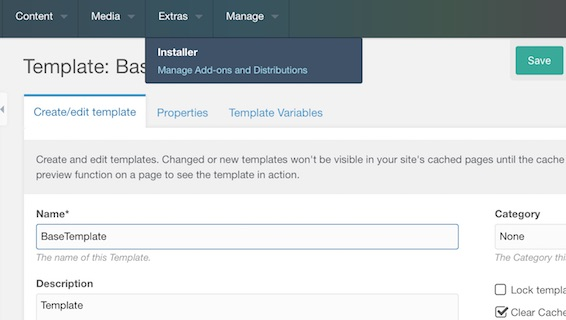
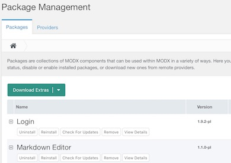
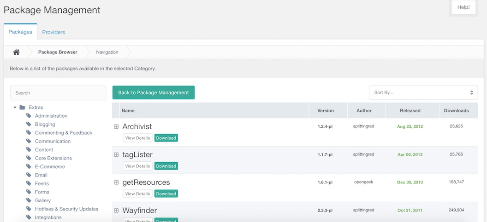

Менеджер пакетов устанавливает, обновляет и удаляет транспортные пакеты — zip-архивы с кодом и данными компонента.

## Где находится страница

**Extras** в верхнем меню → **Installer**. На странице две вкладки: **Packages** и **Providers**.

Менеджер проверяет, загружено ли расширение cURL. Без него над страницей появляется предупреждение, а кнопка **Download Extras** заменяется поиском по локальному каталогу. Подробнее — в [cURL не загружен](building-sites/extras/troubleshooting#ne-zagruzheno-rasshirenie-curl).

## Загрузка пакета

Кнопка **Download Extras** открывает браузер пакетов: слева категории провайдера, справа пакеты. Кнопка **Download** в строке скачивает пакет в `core/packages/`.

Стрелка рядом с кнопкой открывает меню из трёх пунктов:

- **Select a Provider** — выбрать провайдера, у которого скачивать;
- **Search Locally for Packages** — найти архивы в `core/packages/`;
- **Upload a package** — отправить архив в `core/packages/` с компьютера.

## Действия над пакетом

В каждой строке сетки собраны действия над пакетом:

| Действие | Когда оно есть |
| --- | --- |
| **Install** | пакет ещё не установлен |
| **Uninstall** | пакет установлен; кнопка откатывает его элементы |
| **Reinstall** | пакет установлен; кнопка выполняет установку заново поверх него |
| **Update** | включена `auto_check_pkg_updates` и у провайдера есть более новая версия |
| **Check For Updates** | пакет скачан у провайдера, а `auto_check_pkg_updates` выключена, поэтому MODX не знает о более новой версии |
| **Remove** | всегда |
| **View Details** | всегда |

В тулбаре сетки есть одна кнопка, которая работает сразу по всем пакетам: **Purge Old Packages** удаляет старые версии каждого пакета и оставляет установленную.

## Установка пакета

Кнопка **Install** в строке сетки на вкладке **Packages** устанавливает пакет. Перед установкой открывается панель с теми вкладками, которые есть у пакета: Changelog, Dependencies, Readme и License. Readme, Changelog и License отрисовываются как Markdown.

Если у пакета есть параметры установки, их спрашивают в той же панели. Сама установка идёт в консоли, которая отчитывается о каждом шаге.

Пакет, требующий других пакетов, показывает вкладку **Dependencies** в той же панели — см. [Зависимости](#zavisimosti).

## Установка пакета из архива

Пакет можно установить из архива на сервере, без провайдера:

1. положите файл `<signature>.transport.zip` в `core/packages/`;
2. выберите **Search Locally for Packages** в меню кнопки **Download Extras**;
3. архив появится в сетке — установите его как обычно.

Каталог `core/packages/` должен быть доступен PHP для записи.

Тот же архив можно отправить через менеджер. Пункт **Upload a package** того же меню принимает только zip, имя которого оканчивается на `.transport.zip`. Он спрашивает файл и кладёт его в `core/packages/`.

## Обновление пакета

Пакет, скачанный у провайдера, можно проверить на наличие новой версии: кнопка **Check For Updates** в строке открывает окно с версиями, которые предлагает провайдер, и оттуда ставится более новая версия.

Когда настройка `auto_check_pkg_updates` включена, MODX спрашивает у провайдера новейшую версию сам. Тогда в строке стоит кнопка **Update**, если более новая версия есть, и **Check For Updates** — если её нет.

## Удаление установленного пакета

Кнопка **Uninstall** в строке откатывает элементы пакета. Окно спрашивает об одном из трёх режимов:

| Режим | Что делает |
| --- | --- |
| **Preserve** | удаляет новую версию и оставляет предыдущую вместе с настройками и значениями, которые добавил компонент |
| **Uninstall** | удаляет все версии пакета; они остаются в сетке и могут быть установлены снова |
| **Restore** | возвращает настройки предыдущей версии такими, какими они были до установки новой |

Архив, распакованный каталог и запись в базе остаются на месте.

## Удаление пакета из установки

Кнопка **Remove** в строке удаляет пакет из установки. Окно **Delete Package** спрашивает, нужно ли сначала деинсталлировать пакет, — опция **Force Package Removal** удаляет его в любом случае.

При удалении исчезают архив `core/packages/<signature>.transport.zip`, распакованный каталог `core/packages/<signature>/` и запись в базе. Элементы пакета остаются на месте.

## Карточка пакета

Кнопка **View Details** открывает карточку пакета: сигнатуру, провайдера, откуда он пришёл, даты, changelog, readme и лицензию. Сетка на вкладке **Packages** показывает только новейшую версию пакета. Остальные версии перечислены на вкладке **Uploaded Versions** карточки, версию оттуда можно удалить.

Кнопка **Purge Old Packages** в панели инструментов сетки удаляет старые версии всех пакетов разом, оставляя установленную.

## Зависимости

Требования перечислены на вкладке **Dependencies** панели установки, а кнопка **Install all dependencies to continue** ставит их.

С настройкой `abort_install_on_unsatisfied_dependency` — включённой по умолчанию — установка останавливается, пока зависимости не удовлетворены.

Как пакет объявляет зависимости — в [Пакетных зависимостях](extending-modx/transport-packages/dependencies).

## Права

| Право | Что открывает |
| --- | --- |
| `workspaces` | страницу Package Management |
| `packages` | процессоры пакетов |
| `providers` | процессоры провайдеров |
| `file_upload` | загрузку архива |

Все четыре входят в политику Administrator.

## События

| Событие | Когда вызывается |
| --- | --- |
| `OnPackageInstall` | пакет установлен или обновлён |
| `OnPackageUninstall` | пакет деинсталлирован |
| `OnPackageRemove` | пакет удалён из установки или очищен |

Каждое событие передаёт `package`. Событие `OnPackageInstall` передаёт ещё и `action`: `install`, когда пакет ставят впервые, и `upgrade`, когда более новая версия ставится поверх старой.

## Настройки

| Настройка | Значение по умолчанию | Что делает |
| --- | --- | --- |
| [auto_check_pkg_updates](building-sites/settings/auto_check_pkg_updates) | `true` | в строке стоит кнопка **Update** вместо **Check For Updates** |
| [auto_check_pkg_updates_cache_expire](building-sites/settings/auto_check_pkg_updates_cache_expire) | 15 минут | сколько хранится результат проверки |
| [archive_with](building-sites/settings/archive_with) | `false` | `1` распаковывает архивы через PCLZip вместо ZipArchive |
| `abort_install_on_unsatisfied_dependency` | `true` | установка останавливается, пока зависимости пакета не удовлетворены |

Опция `default_provider` называет провайдера, который выбран по умолчанию. Страница её читает, но системной настройкой она не зарегистрирована — см. [modxcms/revolution#17100](https://github.com/modxcms/revolution/issues/17100).

## Процессоры

| Процессор | Право |
| --- | --- |
| `Workspace/Packages/GetList` | `packages` |
| `Workspace/Packages/Get` | `packages` |
| `Workspace/Packages/GetAttribute` | `packages` |
| `Workspace/Packages/GetDependencies` | `packages` |
| `Workspace/Packages/Install` | `packages` |
| `Workspace/Packages/Uninstall` | `packages` |
| `Workspace/Packages/Remove` | `packages` |
| `Workspace/Packages/Update` | `packages` |
| `Workspace/Packages/CheckForUpdates` | `packages` |
| `Workspace/Packages/ScanLocal` | `packages` |
| `Workspace/Packages/Purge` | `packages` |
| `Workspace/Packages/Upload` | `file_upload` |
| `Workspace/Packages/Version/GetList` | `packages` |
| `Workspace/Packages/Version/Remove` | `packages` |
| `Workspace/Packages/Dependency/Download` | `packages` |
| `Workspace/Packages/Rest/GetList` | `packages` |
| `Workspace/Packages/Rest/GetNodes` | `packages` |
| `Workspace/Packages/Rest/GetInfo` | `packages` |
| `Workspace/Packages/Rest/Download` | `packages` |
| `Workspace/Providers/GetList` | `providers` |
| `Workspace/Providers/Create` | `providers` |
| `Workspace/Providers/Update` | `providers` |
| `Workspace/Providers/UpdateFromGrid` | `providers` |
| `Workspace/Providers/Remove` | `providers` |

## Смотрите также

1. [Провайдеры](building-sites/extras/providers)
2. [Поиск проблемы в управлении пакетами](building-sites/extras/troubleshooting)
3. [Транспортные пакеты](extending-modx/transport-packages)
