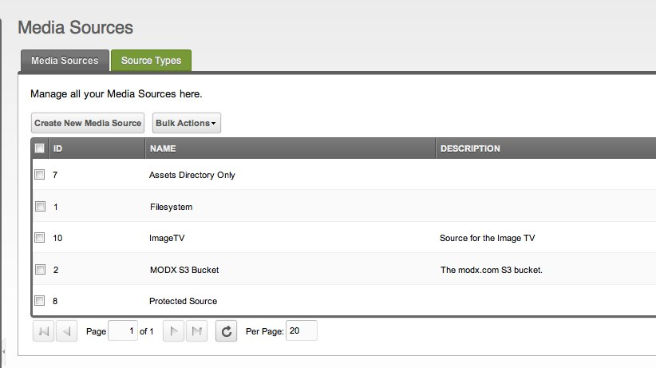
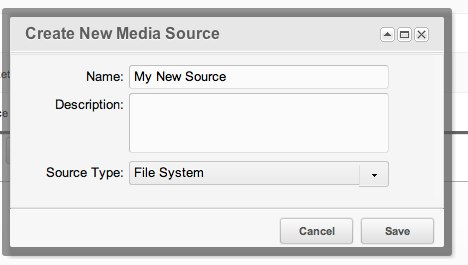

## Создание источника файлов

Источники файлов находятся в разделе **Медиа → Источники файлов**. Страница открывается сеткой источников установки.

У источника есть имя, описание и тип. Тип решает, где лежат файлы, — список типов на странице [Типы источника файлов](building-sites/media-sources/types "Типы источника файлов").

Нажмите **Создать**, откроется окно:

1. Задайте источнику имя.
2. Выберите тип **Файловая система**.
3. Сохраните источник.

Для корзины Amazon S3 сначала прочитайте [Тип источника файлов - S3](building-sites/media-sources/types/media-source-type-s3 "Тип источника файлов - S3").

## Редактирование источника

Откройте источник: щёлкните по его имени в сетке или нажмите правую кнопку мыши и выберите **Редактировать**. На странице редактирования две вкладки: на первой имя, описание, тип и свойства типа, на второй — **Права доступа**.

Для источника файловой системы задайте `basePath` значение `assets/`, а `baseUrl` — `assets/`. Сохраните источник.

**Свойства не спрашивают в окне создания**
Окно создания спрашивает только имя, описание и тип. Свойства появляются на странице редактирования, когда источник уже создан.

## Свойства

У каждого типа свой набор свойств, и они перечислены на странице типа: [Файловая система](building-sites/media-sources/types/media-source-type-file-system "Тип источника файлов - Файловая система"), [FTP](building-sites/media-sources/types/media-source-type-ftp "Тип источника файлов - FTP"), [Amazon S3](building-sites/media-sources/types/media-source-type-s3 "Тип источника файлов - S3").

## Защищённый источник «Filesystem»

В установке есть источник с именем **Filesystem**. Его имя и его тип нельзя изменить, его нельзя удалить. Его свойства и назначенные ему группы пользователей остаются доступными для правки.

## Настройки, указывающие на источник

| Настройка | По умолчанию | Что делает |
| --- | --- | --- |
| `default_media_source` | `1` | Источник, который используется, когда не выбран другой. |
| `default_media_source_type` | `MODX\Revolution\Sources\modFileMediaSource` | Тип, который первым предлагается в окне создания. |
| `photo_profile_source` | пусто | Источник, из которого берутся аватары пользователей. |
| `mgr_source_icon` | `icon-folder-open-o` | Значок источника в дереве файлов. |

## Ограничения загрузки

| Настройка | По умолчанию | Что делает |
| --- | --- | --- |
| `upload_file_exists` | `true` | Когда включено, загрузка файла с уже существующим именем заканчивается ошибкой. Когда выключено, существующий файл заменяется. |
| `upload_maxsize` | `1048576` | Наибольший размер загружаемого файла, в байтах. |
| `upload_translit` | `true` | Транслитерировать ли имя загружаемого файла. |
| `upload_translit_restrict_chars_pattern` | `/[\0\x0B\t\n\r\f\a&=+%#<>"~:`@\?\[\]\{\}\|\^\'\\\\]/` | Символы, которые удаляются из имени. |

## Использование источника

Источник появляется в списке источников дерева файлов слева. Выберите его — и дерево покажет содержимое каталога `assets/`, и ничего больше. Если в установке ещё нет каталога `assets/`, создайте его.

TV берёт источник на вкладке **Источники медиа**. Как это сделать, написано в статье [Назначение источника файлов для TV](building-sites/media-sources/assigning-to-tvs "Назначение источника файлов для TV").

## Смотрите также

1. [Источники файлов](building-sites/media-sources)
2. [Добавление источника файлов](building-sites/media-sources/creating)
3. [Назначение источника файлов для TV](building-sites/media-sources/assigning-to-tvs)
4. [Защита медиа источника](building-sites/media-sources/securing)
   1. [Руководство по созданию источника файлов для клиентов](building-sites/media-sources/securing/clients-tutorial)
5. [Типы источника файлов](building-sites/media-sources/types)
   1. [Тип источника файлов - Файловая система](building-sites/media-sources/types/media-source-type-file-system)
   2. [Тип источника файлов - FTP](building-sites/media-sources/types/media-source-type-ftp)
   3. [Тип источника файлов - S3](building-sites/media-sources/types/media-source-type-s3)
6. [Расширение источников файлов](building-sites/media-sources/extending)
