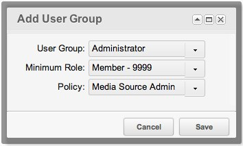
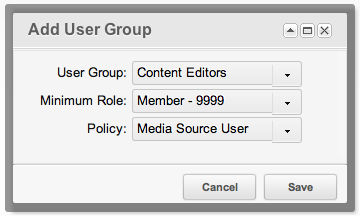

## Как защищается источник

Источник защищается политиками доступа MODX. На вкладке **Права доступа** источника вы привязываете политику к группе пользователей, и эта политика решает, что члены группы могут делать с источником.

Источник без назначенных групп пользователей открыт: им может пользоваться, редактировать и видеть его любой пользователь.

Прочитайте статью [Добавление источника файлов](building-sites/media-sources/creating "Добавление источника файлов") до этой.

## Две штатные политики

MODX поставляет две политики для источников:

| Политика | Критерии |
| --- | --- |
| Media Source Admin | `create`, `copy`, `load`, `list`, `save`, `remove`, `view` |
| Media Source User | `load`, `list`, `view` |

Критерий `load` выдаётся любому источнику, поэтому у политики **Media Source User** работают только `list` и `view`.

## Закрытие источника для группы пользователей

Откройте источник для редактирования и перейдите на вкладку **Права доступа**. Сетка сначала пуста. Нажмите **Добавить группу пользователей**, откроется окно:

Выберите группу пользователей, минимальную роль и политику.

**Media Source Admin** даёт полный доступ: создание, копирование, просмотр, редактирование, удаление и перечисление источника. Сохраните источник.

**Media Source User** подходит группе, которой нужны только файлы. Добавьте в сетку вторую строку — для группы **Редакторы контента** с этой политикой:

Сохраните источник. Теперь члены группы видят источник в дереве файлов, могут назначить его TV и выбирать из него файлы, но не могут изменить сам источник.

Пользователь, который не входит ни в одну группу источника, видит значение TV, использующего этот источник, как обычный текст и не может его изменить.

Откройте меню пользователя и выберите **Доступ → Logout All Users**, после чего войдите снова. Атрибуты пользователя кэшируются в сеансе, поэтому новая политика дойдёт до пользователей только после этого.

## Политика действует и на источник, и на его файлы

Критерии политики относятся и к самому источнику, и к файлам, которые он отдаёт:

| Критерий | Источник | Файлы и папки |
| --- | --- | --- |
| `list` | — | Просмотр папок и файлов |
| `view` | — | Открытие и скачивание файла, распаковка архива |
| `create` | — | Создание файла или папки, загрузка файлов |
| `save` | Редактирование источника | Переименование файла или папки, запись в файл, смена видимости |
| `remove` | Удаление источника | Удаление файла или папки |
| `copy` | Дублирование источника | — |

В политике **Media Source User** нет критерия `create`, поэтому редактор контента не может загружать файлы и создавать папки в источнике.

## Глобальные права

Политика источника работает вместе с глобальными правами менеджера. Пользователю нужно и то, и другое: глобальное право на действие и критерий источника в его политике.

| Действие | Глобальное право | Критерий источника |
| --- | --- | --- |
| Просмотр папок и файлов | `file_list`, `directory_list` | `list` |
| Открытие и скачивание файла | `file_view` | `view` |
| Распаковка архива | `file_unpack` | `view` |
| Создание файла | `file_create` | `create` |
| Загрузка файлов | `file_upload` | `create` |
| Создание папки | `directory_create` | `create` |
| Переименование файла, запись в файл | `file_update` | `save` |
| Переименование папки | `directory_update` | `save` |
| Удаление файла | `file_remove` | `remove` |
| Удаление папки | `directory_remove` | `remove` |
| Смена видимости | `directory_chmod` | `save` |

Для работы с самими источниками нужны такие глобальные права:

| Право | Что открывает |
| --- | --- |
| `sources` | Пункт **Источники файлов** в меню. |
| `source_view` | Сетку источников. |
| `source_save` | Создание источника и сохранение. |
| `source_edit` | Редактирование источника. |
| `source_delete` | Удаление источника. |

## Как отключить проверку

Настройка `access_media_source_enabled` полностью отключает проверку политик источника. По умолчанию она включена. В ядре её нет среди системных настроек, поэтому сайт, которому она нужна, создаёт настройку с таким ключом.

## Смотрите также

1. [Источники файлов](building-sites/media-sources)
2. [Добавление источника файлов](building-sites/media-sources/creating)
3. [Назначение источника файлов для TV](building-sites/media-sources/assigning-to-tvs)
4. [Защита медиа источника](building-sites/media-sources/securing)
   1. [Руководство по созданию источника файлов для клиентов](building-sites/media-sources/securing/clients-tutorial)
5. [Типы источника файлов](building-sites/media-sources/types)
   1. [Тип источника файлов - Файловая система](building-sites/media-sources/types/media-source-type-file-system)
   2. [Тип источника файлов - FTP](building-sites/media-sources/types/media-source-type-ftp)
   3. [Тип источника файлов - S3](building-sites/media-sources/types/media-source-type-s3)
6. [Расширение источников файлов](building-sites/media-sources/extending)
