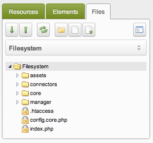
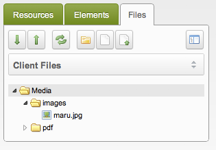
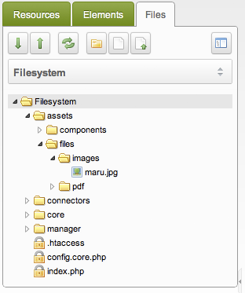

## Что делает это руководство

Руководство настраивает второй источник для клиентов. Файлы сайта остаются вне их файлового менеджера, а клиенты получают собственный каталог.

Сделайте это до того, как клиенты загрузят что-либо. Для установки, которая уже в работе, сначала прочитайте [Устранение неполадок: существующие установки](#ustranenie-nepoladok-sushchestvuyushchie-ustanovki).

По умолчанию файловый менеджер выглядит так:

С отдельным источником для клиентов он выглядит так:

## Шаг 1: Создайте структуру каталогов

Сделайте в `/assets/` папку `files`, а в ней ещё две: `pdf` и `images`. Файлы клиентов попадут в эти две папки.

Права на папки задавать не нужно. Ядро записывает новые файлы с правами `0644`, а новые папки — с правами `0755`; изменить это можно настройками `new_file_permissions` и `new_folder_permissions`.

Источник должен выглядеть так:

## Шаг 2: Скройте источник Filesystem

1. Перейдите в **Медиа → Источники файлов**.
2. Откройте источник **Filesystem** для редактирования.
3. Перейдите на вкладку **Права доступа**.
4. Нажмите **Добавить группу пользователей**.
5. Выберите группу **Administrator**, роль **Member** и политику **Media Source Admin**. Все члены группы смогут добавлять и удалять источники. Клиентов держите в другой группе. Если они в группе администраторов, задайте минимальную роль **Super User** — тогда до источника дойдут только пользователи с этой ролью.
6. Нажмите **Готово**, затем сохраните источник.

Клиент, который войдёт в систему, теперь не увидит ни одного файла. Следующий шаг даст клиентам их собственный источник.

## Шаг 3: Добавьте источник файлов клиентов

1. Перейдите в **Медиа → Источники файлов**.
2. Нажмите **Создать**.
3. Назовите источник `Client Files`, оставьте тип **Файловая система** и сохраните.
4. Откройте источник для редактирования и задайте `basePath` значение `assets/files/`, а `baseUrl` — `assets/files/`. Первый говорит MODX, где искать на сервере, второй — где искать в сети. Оставьте `basePathRelative` и `baseUrlRelative` включёнными, чтобы оба значения оставались относительными установки. Сайту, который использует свой домен для каждого контекста, могут понадобиться абсолютные значения.
5. Сохраните источник.

Клиенты теперь могут войти, но файловый менеджер по-прежнему открывается с тем источником, к которому у них нет доступа. Переключиться на свой они могут, но это сбивает с толку. Следующий шаг убирает переключение.

## Шаг 4: Задайте источник по умолчанию

1. Откройте меню пользователя и выберите **Админ → Системные настройки**.
2. Отфильтруйте по области и выберите **Система управления**.
3. Найдите настройку **Источник мультимедиа по умолчанию** и смените значение с **Filesystem** на **Client Files**.
4. Дождитесь, пока MODX сохранит настройку.

Клиенты теперь видят **Client Files** как источник по умолчанию и пользуются им как обычно. Новые TV типов «Изображение» и «Файл» указывают на то же место.

## Устранение неполадок: существующие установки

Сайту, на котором уже есть TV и загруженные изображения, после шагов 1–4 нужно обновить пути:

1. Перенесите файлы на новое место. Путь относительно источника остаётся тем же.
2. Переключите TV на новый источник.

## Смотрите также

1. [Источники файлов](building-sites/media-sources)
2. [Добавление источника файлов](building-sites/media-sources/creating)
3. [Назначение источника файлов для TV](building-sites/media-sources/assigning-to-tvs)
4. [Защита медиа источника](building-sites/media-sources/securing)
   1. [Руководство по созданию источника файлов для клиентов](building-sites/media-sources/securing/clients-tutorial)
5. [Типы источника файлов](building-sites/media-sources/types)
   1. [Тип источника файлов - Файловая система](building-sites/media-sources/types/media-source-type-file-system)
   2. [Тип источника файлов - FTP](building-sites/media-sources/types/media-source-type-ftp)
   3. [Тип источника файлов - S3](building-sites/media-sources/types/media-source-type-s3)
6. [Расширение источников файлов](building-sites/media-sources/extending)
