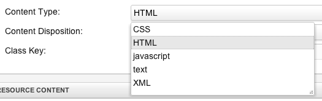
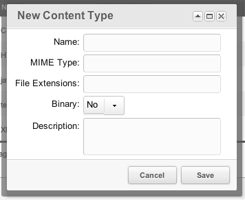

## Что такое типы содержимого?

Тип содержимого связывает ресурсы с MIME-типом и одним или несколькими расширениями файлов. MODX использует его, чтобы построить URI ресурса и отправить заголовок `Content-Type`.

При включённых дружественных URL MODX добавляет первое расширение типа содержимого к псевдониму ресурса. Например, [ресурс](building-sites/resources) с псевдонимом `test` и типом содержимого CSS с расширением `.css` отдаётся как:

> test.css

а не `test.html`. Так из ресурсов можно отдавать CSS, XML, JSON и другие файлы.

## Использование

При редактировании ресурса откройте вкладку **Настройки** и выберите тип содержимого:



Сохраните [ресурс](building-sites/resources). MODX свяжет его с выбранным типом.

### Создание новых типов содержимого

Откройте **Содержимое > Типы содержимого**. В таблице перечислены текущие типы. Нажмите **Новый тип содержимого**, чтобы открыть окно:



Поля:

- **Название** — подпись в менеджере. На вывод не влияет.
- **MIME-тип** — заголовок `Content-Type` для браузера, например `text/css`.
- **Расширение файла** — расширения с точкой (`.css`). Несколько значений разделяйте запятыми: `.html,.htm`. Первое расширение MODX использует при построении URI.
- **Значок** — необязательный CSS-класс иконки в дереве ресурсов (MODX 3.0+): `icon-css`, `icon-json`, `icon-pdf`, `icon-home` или `fa-home`.
- **Двоичный** — является ли файл двоичным. Бинарные типы отдаются как есть, текстовые получают кодировку.
- **Описание** — необязательная заметка для пользователей менеджера.
- **Пользовательские заголовки** — полные строки HTTP-заголовков, по одной в строке. См. ниже.

Нажмите **Сохранить**, чтобы добавить тип в таблицу.

### Пользовательские заголовки

Вкладка **Пользовательские заголовки** хранит полные строки заголовков, например:

```text
X-Frame-Options: DENY
```

MODX отправляет эти заголовки с каждым ресурсом этого типа. Для бинарных статических ресурсов заголовки отправляются перед потоковой передачей файла.

### Защищённые типы содержимого

MODX поставляется с восемью защищёнными типами:

- HTML
- XML
- Text
- CSS
- JavaScript
- RSS
- JSON
- PDF

В менеджере у защищённого типа нет действия **Удалить**. Его имя, MIME-тип и описание доступны только для чтения, а иконку и расширения файлов менять можно. Для создания, редактирования и удаления типа нужна привилегия `content_types`.

### Иконки в дереве ресурсов

MODX добавляет в узел дерева все подходящие CSS-классы: иконку типа содержимого и класс иконки шаблона, а также классы типа и значения по умолчанию. Возвращаются оба класса, поэтому видимую иконку выбирает CSS темы.

Если ни тип содержимого, ни шаблон не задают иконку, MODX использует `mgr_tree_icon_{classKey}` — например `tree-resource` для документа. У веб-ссылок, символических ссылок и статических ресурсов есть свои значения по умолчанию.

Встроенные типы содержимого поставляются с иконками для не-HTML MIME-типов: `icon-xml`, `icon-css`, `icon-js`, `icon-json`, `icon-pdf` и подобными. У HTML иконка обычно пустая, поэтому остаётся обычная иконка документа или папки.

Иконку можно менять прямо в таблице типов или в окне создания и редактирования. О классе иконки шаблона см. [Шаблоны](building-sites/elements/templates).

## Смотрите также

- [Ресурсы](building-sites/resources)
- [Статический ресурс](building-sites/resources/static-resource)
