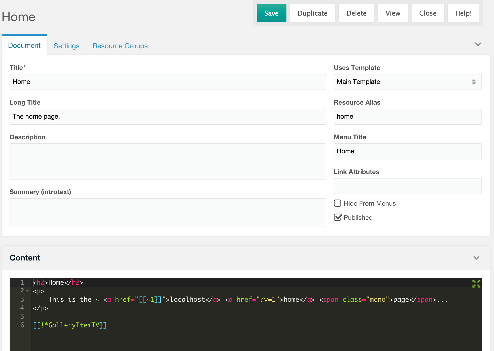

## Что такое ресурс?

Ресурс — это страница или другой элемент, которым управляет MODX. Встроенных типов четыре: документы, веб-ссылки, символические ссылки и статические ресурсы. [Пользовательские классы ресурсов](building-sites/resources/custom-resources) добавляют новые типы.

У каждого ресурса есть ID. Используйте ID в тегах ссылок, чтобы MODX сам строил URL: псевдонимы и типы содержимого могут меняться, а ссылки останутся рабочими.

### Управление ресурсами

Ресурсы видны в дереве ресурсов слева. Нажмите на ресурс, чтобы открыть его, или щёлкните правой кнопкой и выберите **Редактировать**. Откроется страница редактирования:



Содержимое редактируется в основном поле, остальные поля — на вкладках.

### Вкладка «Группы ресурсов» и чекбокс Access

Вкладка **Группы ресурсов** показывает все группы ресурсов сайта. Колонка **Access** (**Доступ**) означает членство, а не выдачу ACL.

- Отметьте **Access** и сохраните: ресурс войдёт в группу.
- Снимите **Access** и сохраните: ресурс выйдет из группы.

Страница остаётся публичной, пока группа не связана с группой пользователей и ACL. См. [Группы ресурсов](building-sites/client-proofing/security/resource-groups).

У нового ресурса под родителем, который уже входит в группы, эти чекбоксы отмечены. Для просмотра и изменения нужна привилегия `resourcegroup_resource_edit`.

## Поля ресурса

В таблицах перечислены поля страницы редактирования. `id` наследуется, остальные поля — колонки `modx_site_content`.

### Поля содержимого

| Имя | Описание |
| --- | --- |
| id | ID ресурса. |
| pagetitle | Заголовок ресурса. |
| longtitle | Длинный заголовок ресурса. |
| description | Расширенное описание ресурса. |
| introtext | Вводный фрагмент, он же Summary. Полезен для блогов и поиска. |
| alias | Псевдоним URL для дружественных URL. Ресурс с псевдонимом `home` и HTML-типом содержимого отдаётся как `home.html`, если это не контейнер. |
| alias\_visible | Показывать ли псевдоним в URI дочерних ресурсов, когда включены пути по псевдонимам. |
| parent | ID родительского ресурса. |
| type | Устаревшая метка типа, `document` или `reference`. MODX выбирает поведение по `class_key`, а не по этому полю. |
| class\_key | Полное имя класса ресурса. Для документа это `MODX\Revolution\modDocument`. См. [Пользовательские классы ресурсов](building-sites/resources/custom-resources). |
| context\_key | Ключ контекста, к которому относится ресурс; обычно `web`. |
| template | [Шаблон](building-sites/elements/templates) ресурса. |
| content\_type | ID [типа содержимого](building-sites/resources/content-types). Задаёт MIME-тип и расширение файла. |
| content | Содержимое ресурса. Его смысл зависит от типа; см. таблицу ниже. |
| richtext | Использует ли ресурс визуальный редактор, если он установлен. |

#### Содержимое по типу ресурса

| Тип | Что хранит `content` |
| --- | --- |
| Документ | HTML и теги MODX. |
| Веб-ссылка | URL или ID ресурса для перенаправления. |
| Символическая ссылка | ID целевого ресурса. |
| Статический ресурс | Путь к файлу относительно `resource_static_path` или абсолютный, если это разрешено. |

### Поля публикации и меню

| Имя | Описание |
| --- | --- |
| published | Опубликован ли ресурс и виден ли он на сайте. |
| pub\_date | Дата и время, когда ресурс должен опубликоваться. |
| unpub\_date | Дата и время, когда ресурс должен сняться с публикации. |
| isfolder | Поле **Контейнер**. Из-за него дружественный URL заканчивается на `/`, а не на расширении типа содержимого. |
| hidemenu | Поле **Скрыть из меню**. Большинство меню и навигационных сниппетов пропускают ресурс. |
| menutitle | Заголовок, который показывается в меню. |
| menuindex | Порядок в меню. Большее значение — позже. |
| link\_attributes | Атрибуты, которые сниппеты меню добавляют к ссылкам. Можно использовать иначе. |
| searchable | Участвует ли ресурс в поиске. |
| cacheable | Кешируется ли вывод ресурса. |

### Системные поля

| Имя | Описание |
| --- | --- |
| createdby | ID пользователя, создавшего ресурс. |
| createdon | Дата создания ресурса. |
| editedby | ID последнего пользователя, редактировавшего ресурс. |
| editedon | Дата последнего редактирования. |
| publishedby | ID пользователя, который последним опубликовал ресурс. |
| publishedon | Дата публикации. |
| deleted | Удалён ли ресурс. |
| deletedby | ID пользователя, удалившего ресурс. |
| deletedon | Дата удаления. |
| content\_dispo | `0` — отдавать бинарный файл в браузере, `1` — как вложение. |
| uri | Построенный URI. Замораживается через `uri_override`. |
| uri\_override | Сохранить текущий URI и не перестраивать его. |
| show\_in\_tree | Показывать ресурс в дереве менеджера. |
| hide\_children\_in\_tree | Скрыть дочерние ресурсы в дереве менеджера. |
| properties | JSON-объект свойств с пространствами имён. Веб-ссылки хранят здесь `responseCode`. |

### Использование полей ресурса

Поля доступны в шаблонах и содержимом через синтаксис [переменных шаблона](building-sites/elements/template-variables):

```text
[[*pagetitle]]
[[*id]]
[[*createdby]]
```

Они выводят заголовок страницы, ID ресурса и ID создавшего пользователя.

[Фильтры вывода](building-sites/tag-syntax/output-filters) изменяют значение:

```text
[[*introtext:ellipsis=`100`]]
[[*editedby:userinfo=`username`]]
[[*publishedby:userinfo=`email`]]
```

Первый пример ограничивает `introtext` сотней символов и добавляет многоточие. Остальные возвращают имя и email пользователей, которые редактировали и публиковали ресурс.

### Доступ к полям из сниппета

[Сниппет](extending-modx/snippets) получает текущий ресурс как `$modx->resource`. Этот пример возвращает перевёрнутый заголовок страницы:

```php
$output = $modx->resource->get('pagetitle');
return strrev($output);
```

## Ссылки на ресурсы

Теги ссылок строят URL ресурсов:

```text
[[~123]]
```

`123` — ID ресурса. MODX строит URL во время запроса.

См. также [именованный якорь](building-sites/integrating-templates/named-anchor).

### Параметры URL в тегах ссылок

Параметры добавляются в тег ссылки через обратные кавычки:

```text
[[~42? &tag=`Snacks` &sort=`Taste`]]
```

Если ресурс 42 отдаётся по адресу `store/items.html`, тег выведет:

```text
store/items.html?tag=Snacks&sort=Taste
```

### Схемы URL в тегах ссылок

Схема задаётся свойством `scheme`:

```text
[[~123? &scheme=`https`]]
```

Доступные схемы:

| Имя | Описание |
| --- | --- |
| -1 | (по умолчанию) URL относительно `site_url` |
| 0 | Принудительно `http`, если текущий запрос идёт по `https` |
| 1 | Принудительно `https`, если текущий запрос идёт по `http` |
| full | Абсолютный URL с `site_url` |
| abs | Абсолютный URL с `base_url` |
| http | Абсолютный URL со схемой `http` |
| https | Абсолютный URL со схемой `https` |

## Смотрите также

1. [Типы содержимого](building-sites/resources/content-types)
2. [Пользовательские классы ресурсов](building-sites/resources/custom-resources)
3. [Именованный якорь](building-sites/integrating-templates/named-anchor)
4. [Статический ресурс](building-sites/resources/static-resource)
5. [Символическая ссылка](building-sites/resources/symlink)
    1. [Использование символических ссылок](building-sites/resources/symlink/using-resource-symlinks)
6. [Веб-ссылка](building-sites/resources/weblink)
7. [Группы ресурсов](building-sites/client-proofing/security/resource-groups)
