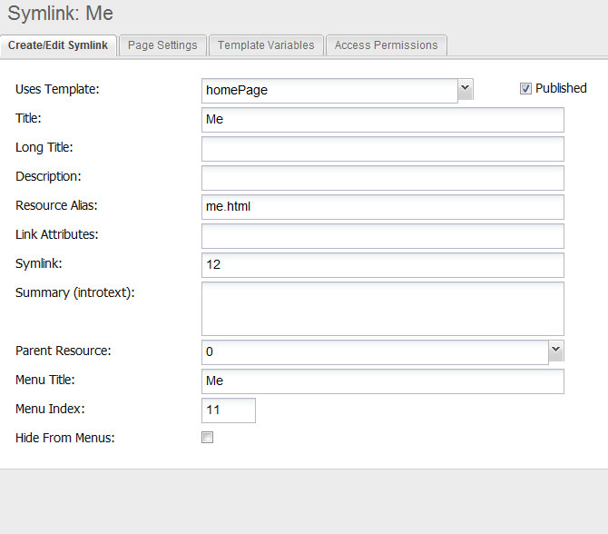

## Понимание символической ссылки

Символическая ссылка переадресует запрос другому ресурсу и возвращает его вывод по собственному URL. Содержимое не копируется, HTTP-перенаправление не отправляется. Ссылку можно разместить в любом месте дерева, и у каждой будет свой URL. Используйте её, чтобы сохранить старый URL, показать ресурс в нескольких местах, сократить длинный URL или закрыть варианты написания.

Символическая ссылка MODX — не файловый симлинк. Она переадресует запросы только внутри MODX.

## Создание символической ссылки

1. Создайте ресурс и выберите тип **Символическая ссылка** или используйте **Создать символическую ссылку** в дереве ресурсов.
2. Укажите заголовок и псевдоним.
3. Запишите в поле содержимого ID целевого ресурса.
4. Сохраните, затем очистите кеш сайта и кеш документов, если цель не появилась.

Цель должна быть ID ресурса. URL или псевдоним не работают; для внешних адресов используйте [веб-ссылку](building-sites/resources/weblink).

## Объединение полей

Когда [`symlink_merge_fields`](building-sites/settings/symlink_merge_fields) включена (по умолчанию), непустые поля символической ссылки перекрывают поля цели при переадресации. Поэтому ссылка может использовать свой шаблон, заголовок меню и другие значения, показывая содержимое цели.

Некоторые поля не объединяются никогда:

| Поле | Причина |
| --- | --- |
| `content` | Всегда ID целевого ресурса. |
| `pub_date`, `unpub_date` | Даты публикации принадлежат цели. |
| `richtext` | Сохраняется настройка редактора цели. |
| `_content`, `_processed` | Внутренние значения времени выполнения. |

Список [`forward_merge_excludes`](building-sites/settings/forward_merge_excludes) по умолчанию также защищает `type`, `published` и `class_key`. Добавьте в настройку имена полей через запятую, чтобы защитить другие поля.

Когда `symlink_merge_fields` выключена, MODX использует поля цели и игнорирует переопределения ссылки, кроме URL и ID цели.

## SEO

URL символической ссылки отдаёт 200 и показывает содержимое цели. Поисковые системы могут проиндексировать оба URL как дубликаты. Добавьте канонический тег в шаблон ссылки, если URL не должны конкурировать, или используйте [веб-ссылку](building-sites/resources/weblink) с кодом 301, когда старый URL должен постоянно переехать.

## Пример

В этом примере содержимое страницы об образовании отдаётся по адресу `me.html`.

## Смотрите также

1. [Типы содержимого](building-sites/resources/content-types)
2. [Именованный якорь](building-sites/integrating-templates/named-anchor)
3. [Статический ресурс](building-sites/resources/static-resource)
4. [Символическая ссылка](building-sites/resources/symlink)
5. [Веб-ссылка](building-sites/resources/weblink)
