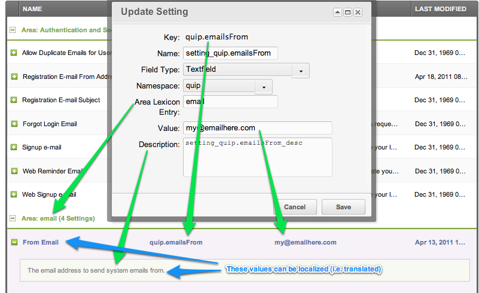

Системные настройки действуют на весь сайт. Редактируйте их в разделе «Система» → «Системные настройки». В шаблонах значение доступно как `[[++key]]`, в PHP — через `$modx->getOption('key')`.

## Переопределение настроек (наследование)

Настройку можно переопределить на четырёх уровнях. Для вошедшего пользователя MODX проверяет их в таком порядке:

1. Настройка пользователя
2. Настройка группы пользователей
3. Настройка контекста (в менеджере обычно `mgr`)
4. Системная настройка

## Создание системной настройки в менеджере

Откройте «Система» → «Системные настройки» и нажмите «Создать».



### Параметры

| Поле | Назначение |
|---|---|
| Ключ | Уникальное имя для `[[++key]]` и `getOption()`. |
| Имя | Подпись в списке настроек; может быть локализована. |
| Тип поля | xtype поля; см. [Типы системных настроек](#tipy-sistemnyh-nastroek). |
| Пространство имён | Папка внутри `core/components/`, как у [пользовательских страниц менеджера](extending-modx/custom-manager-pages). |
| Area Lexicon Entry | Группирует настройки с одинаковым значением. |
| Значение | Значение по умолчанию. |
| Описание | Подсказка; может быть локализована. |

### Локализация

Имя и описание берутся из записей лексикона:

- Имя: `setting_` + ключ
- Описание: `setting_` + ключ + `_desc`

В пакете эти записи лежат в `core/components/<namespace>/lexicon/<language>/default.inc.php`:

```php
$_lang['setting_quip.emailsFrom'] = 'From Email';
$_lang['setting_quip.emailsFrom_desc'] = 'The email address to send system emails from.';
```

## Чтение настройки в коде

Передайте ключ настройки в `getOption()`:

```php
$siteStartId = $modx->getOption('site_start');
```

`getOption()` читает кэш настроек, а не базу данных.

## Сохранение настройки в коде

Значение из `getOption()` кэшируется и доступно только для чтения. Чтобы изменить настройку, загрузите объект `modSystemSetting`, обновите его, сохраните и очистите кэш.

### Обновление объекта

```php
use MODX\Revolution\modSystemSetting;

$setting = $modx->getObject(modSystemSetting::class, 'site_name');
if ($setting) {
    $setting->set('value', 'My New Site Name');
    $setting->save();
}
```

### Очистка кэша

Сохранение не обновляет кэш настроек. Очистите `system_settings`; добавьте `resource`, если значение используется на сайте:

```php
$modx->cacheManager->refresh([
    'system_settings' => [],
    'resource' => [],
]);
```

### Метаданные настройки

```php
use MODX\Revolution\modSystemSetting;

$setting = $modx->getObject(modSystemSetting::class, 'site_name');
print_r($setting->toArray());
```

## Список связанных настроек

Группируйте настройки по `area` или по префиксу ключа.

### По области

```php
use MODX\Revolution\modSystemSetting;

$relatedSettings = $modx->getCollection(modSystemSetting::class, ['area' => 'mail']);
foreach ($relatedSettings as $setting) {
    print $setting->get('value');
}
```

### По префиксу ключа

```php
use MODX\Revolution\modSystemSetting;

$query = $modx->newQuery(modSystemSetting::class);
$query->where(['key:LIKE' => 'quip.%']);
$relatedSettings = $modx->getCollection(modSystemSetting::class, $query);
foreach ($relatedSettings as $setting) {
    print $setting->get('value');
}
```

## Создание настройки в коде

```php
use MODX\Revolution\modSystemSetting;

$setting = $modx->newObject(modSystemSetting::class);
$setting->set('key', 'mykey');
$setting->set('value', 'my_value');
$setting->set('xtype', 'textfield');
$setting->set('namespace', 'my_namespace');
$setting->set('area', 'MyArea');
$setting->save();

$modx->cacheManager->refresh(['system_settings' => []]);
```

Добавьте записи лексикона, чтобы у настройки появились имя и описание:

```php
$_lang['setting_mykey'] = 'Name of My Setting';
$_lang['setting_mykey_desc'] = 'Description of my key';
```

Чтобы вывести подпись настройки в шаблоне или пользовательской странице менеджера, вызовите тег лексикона с темой `setting`:

```php
[[!%setting_emailsender? &topic=`setting` &namespace=`core` &language=`en`]]
```

## Типы системных настроек

Атрибут `xtype` задаёт поле, которое используется в менеджере:

| xtype | Поле |
|---|---|
| `combo-boolean` | Да/Нет; хранит `1` или `0` |
| `textfield` | Однострочный текст |
| `textarea` | Многострочный текст |
| `text-password` | Скрытый текст |
| `numberfield` | Число |
| `modx-combo-language` | Выбор языка |
| `modx-combo-source` | Выбор источника медиа |
| `modx-combo-template` | Выбор шаблона |
| `modx-combo-content-type` | Выбор типа содержимого |
| `modx-combo-charset` | Выбор кодировки |
| `modx-combo-rte` | Выбор визуального редактора |
| `modx-combo-context` | Выбор контекста |
| `modx-combo-namespace` | Выбор пространства имён |
| `modx-combo-manager-theme` | Выбор темы менеджера |

## Список настроек

1. [access_category_enabled](building-sites/settings/access_category_enabled)
2. [access_context_enabled](building-sites/settings/access_context_enabled)
3. [access_resource_group_enabled](building-sites/settings/access_resource_group_enabled)
4. [allow_duplicate_alias](building-sites/settings/allow_duplicate_alias)
5. [allow_forward_across_contexts](building-sites/settings/allow_forward_across_contexts)
6. [allow_manager_login_forgot_password](building-sites/settings/allow_manager_login_forgot_password)
7. [allow_multiple_emails](building-sites/settings/allow_multiple_emails)
8. [allow_tags_in_post](building-sites/settings/allow_tags_in_post)
9. [allow_tv_eval](building-sites/settings/allow_tv_eval)
10. [anonymous_sessions](building-sites/settings/anonymous_sessions)
11. [archive_with](building-sites/settings/archive_with)
12. [automatic_alias](building-sites/settings/automatic_alias)
13. [automatic_template_assignment](building-sites/settings/automatic_template_assignment)
14. [auto_check_pkg_updates](building-sites/settings/auto_check_pkg_updates)
15. [auto_check_pkg_updates_cache_expire](building-sites/settings/auto_check_pkg_updates_cache_expire)
16. [auto_isfolder](building-sites/settings/auto_isfolder)
17. [auto_menuindex](building-sites/settings/auto_menuindex)
18. [base_help_url](building-sites/settings/base_help_url)
19. [blocked_minutes](building-sites/settings/blocked_minutes)
20. [cache_action_map](building-sites/settings/cache_action_map)
21. [cache_alias_map](building-sites/settings/cache_alias_map)
22. [cache_context_settings](building-sites/settings/cache_context_settings)
23. [cache_db](building-sites/settings/cache_db)
24. [cache_db_expires](building-sites/settings/cache_db_expires)
25. [cache_db_session](building-sites/settings/cache_db_session)
26. [cache_db_session_lifetime](building-sites/settings/cache_db_session_lifetime)
27. [cache_default](building-sites/settings/cache_default)
28. [cache_disabled](building-sites/settings/cache_disabled)
29. [cache_format](building-sites/settings/cache_format)
30. [cache_handler](building-sites/settings/cache_handler)
31. [cache_json](building-sites/settings/cache_json)
32. [cache_json_expires](building-sites/settings/cache_json_expires)
33. [cache_lang_js](building-sites/settings/cache_lang_js)
34. [cache_lexicon_topics](building-sites/settings/cache_lexicon_topics)
35. [cache_noncore_lexicon_topics](building-sites/settings/cache_noncore_lexicon_topics)
36. [cache_resource](building-sites/settings/cache_resource)
37. [cache_resource_clear_partial](building-sites/settings/cache_resource_clear_partial)
38. [cache_resource_expires](building-sites/settings/cache_resource_expires)
39. [cache_scripts](building-sites/settings/cache_scripts)
40. [cache_system_settings](building-sites/settings/cache_system_settings)
41. [clear_cache_refresh_trees](building-sites/settings/clear_cache_refresh_trees)
42. [compress_css](building-sites/settings/compress_css)
43. [compress_js](building-sites/settings/compress_js)
44. [compress_js_groups](building-sites/settings/compress_js_groups)
45. [compress_js_max_files](building-sites/settings/compress_js_max_files)
46. [concat_js](building-sites/settings/concat_js)
47. [confirm_navigation](building-sites/settings/confirm_navigation)
48. [container_suffix](building-sites/settings/container_suffix)
49. [context_tree_sortby](building-sites/settings/context_tree_sortby)
50. [context_tree_sortdir](building-sites/settings/context_tree_sortdir)
51. [context_tree_sort](building-sites/settings/context_tree_sort)
52. [cultureKey](building-sites/settings/culturekey)
53. [custom_resource_classes](building-sites/settings/custom_resource_classes)
54. [date_timezone](building-sites/settings/date_timezone)
55. [debug](building-sites/settings/debug)
56. [default_content_type](building-sites/settings/default_content_type)
57. [default_context](building-sites/settings/default_context)
58. [default_duplicate_publish_option](building-sites/settings/default_duplicate_publish_option)
59. [default_media_source](building-sites/settings/default_media_source)
60. [default_media_source_type](building-sites/settings/default_media_source_type)
61. [default_per_page](building-sites/settings/default_per_page)
62. [default_template](building-sites/settings/default_template)
63. [default_username](building-sites/settings/default_username)
64. [editor_css_path](building-sites/settings/editor_css_path)
65. [editor_css_selectors](building-sites/settings/editor_css_selectors)
66. [emailsender](building-sites/settings/emailsender)
67. [emailsubject](building-sites/settings/emailsubject)
68. [enable_dragdrop](building-sites/settings/enable_dragdrop)
69. [enable_gravatar](building-sites/settings/enable_gravatar)
70. [enable_template_picker_in_tree](building-sites/settings/enable_template_picker_in_tree)
71. [error_log_filename](building-sites/settings/error_log_filename)
72. [error_log_filepath](building-sites/settings/error_log_filepath)
73. [error_page](building-sites/settings/error_page)
74. [extension_packages](building-sites/settings/extension_packages)
75. [failed_login_attempts](building-sites/settings/failed_login_attempts)
76. [feed_modx_news](building-sites/settings/feed_modx_news)
77. [feed_modx_news_enabled](building-sites/settings/feed_modx_news_enabled)
78. [feed_modx_security](building-sites/settings/feed_modx_security)
79. [feed_modx_security_enabled](building-sites/settings/feed_modx_security_enabled)
80. [fe_editor_lang](building-sites/settings/fe_editor_lang)
81. [filemanager_path](building-sites/settings/filemanager_path)
82. [filemanager_path_relative](building-sites/settings/filemanager_path_relative)
83. [filemanager_url](building-sites/settings/filemanager_url)
84. [filemanager_url_relative](building-sites/settings/filemanager_url_relative)
85. [forgot_login_email](building-sites/settings/forgot_login_email)
86. [form_customization_use_all_groups](building-sites/settings/form_customization_use_all_groups)
87. [forward_merge_excludes](building-sites/settings/forward_merge_excludes)
88. [friendly_alias_lowercase_only](building-sites/settings/friendly_alias_lowercase_only)
89. [friendly_alias_max_length](building-sites/settings/friendly_alias_max_length)
90. [friendly_alias_realtime](building-sites/settings/friendly_alias_realtime)
91. [friendly_alias_restrict_chars](building-sites/settings/friendly_alias_restrict_chars)
92. [friendly_alias_restrict_chars_pattern](building-sites/settings/friendly_alias_restrict_chars_pattern)
93. [friendly_alias_strip_element_tags](building-sites/settings/friendly_alias_strip_element_tags)
94. [friendly_alias_translit](building-sites/settings/friendly_alias_translit)
95. [friendly_alias_translit_class](building-sites/settings/friendly_alias_translit_class)
96. [friendly_alias_translit_class_path](building-sites/settings/friendly_alias_translit_class_path)
97. [friendly_alias_trim_chars](building-sites/settings/friendly_alias_trim_chars)
98. [friendly_alias_word_delimiters](building-sites/settings/friendly_alias_word_delimiters)
99. [friendly_alias_word_delimiter](building-sites/settings/friendly_alias_word_delimiter)
100. [friendly_url_prefix](building-sites/settings/friendly_url_prefix)
101. [friendly_url_suffix](building-sites/settings/friendly_url_suffix)
102. [friendly_urls](building-sites/settings/friendly_urls)
103. [friendly_urls_strict](building-sites/settings/friendly_urls_strict)
104. [global_duplicate_uri_check](building-sites/settings/global_duplicate_uri_check)
105. [hidemenu_default](building-sites/settings/hidemenu_default)
106. [inherit_parent_template](building-sites/settings/inherit_parent_template)
107. [inline_help](building-sites/settings/inline_help)
108. [link_tag_scheme](building-sites/settings/link_tag_scheme)
109. [locale](building-sites/settings/locale)
110. [lock_ttl](building-sites/settings/lock_ttl)
111. [log_deprecated](building-sites/settings/log_deprecated)
112. [log_level](building-sites/settings/log_level)
113. [log_snippet_not_found](building-sites/settings/log_snippet_not_found)
114. [log_target](building-sites/settings/log_target)
115. [login_background_image](building-sites/settings/login_background_image)
116. [login_help_button](building-sites/settings/login_help_button)
117. [login_logo](building-sites/settings/login_logo)
118. [mail_charset](building-sites/settings/mail_charset)
119. [mail_dkim_domain](building-sites/settings/mail_dkim_domain)
120. [mail_dkim_identity](building-sites/settings/mail_dkim_identity)
121. [mail_dkim_passphrase](building-sites/settings/mail_dkim_passphrase)
122. [mail_dkim_privatekeyfile](building-sites/settings/mail_dkim_privatekeyfile)
123. [mail_dkim_privatekeystring](building-sites/settings/mail_dkim_privatekeystring)
124. [mail_dkim_selector](building-sites/settings/mail_dkim_selector)
125. [mail_encoding](building-sites/settings/mail_encoding)
126. [mail_smtp_auth](building-sites/settings/mail_smtp_auth)
127. [mail_smtp_autotls](building-sites/settings/mail_smtp_autotls)
128. [mail_smtp_helo](building-sites/settings/mail_smtp_helo)
129. [mail_smtp_hosts](building-sites/settings/mail_smtp_hosts)
130. [mail_smtp_keepalive](building-sites/settings/mail_smtp_keepalive)
131. [mail_smtp_pass](building-sites/settings/mail_smtp_pass)
132. [mail_smtp_port](building-sites/settings/mail_smtp_port)
133. [mail_smtp_secure](building-sites/settings/mail_smtp_secure)
134. [mail_smtp_single_to](building-sites/settings/mail_smtp_single_to)
135. [mail_smtp_timeout](building-sites/settings/mail_smtp_timeout)
136. [mail_smtp_user](building-sites/settings/mail_smtp_user)
137. [mail_use_smtp](building-sites/settings/mail_use_smtp)
138. [main_nav_parent](building-sites/settings/main_nav_parent)
139. [manager_date_format](building-sites/settings/manager_date_format)
140. [manager_datetime_empty_value](building-sites/settings/manager_datetime_empty_value)
141. [manager_datetime_separator](building-sites/settings/manager_datetime_separator)
142. [manager_direction](building-sites/settings/manager_direction)
143. [manager_favicon_url](building-sites/settings/manager_favicon_url)
144. [manager_html5_cache](building-sites/settings/manager_html5_cache)
145. [manager_js_cache_file_locking](building-sites/settings/manager_js_cache_file_locking)
146. [manager_js_cache_max_age](building-sites/settings/manager_js_cache_max_age)
147. [manager_js_document_root](building-sites/settings/manager_js_document_root)
148. [manager_js_zlib_output_compression](building-sites/settings/manager_js_zlib_output_compression)
149. [manager_language](building-sites/settings/manager_language)
150. [manager_lang_attribute](building-sites/settings/manager_lang_attribute)
151. [manager_login_url_alternate](building-sites/settings/manager_login_url_alternate)
152. [manager_logo](building-sites/settings/manager_logo)
153. [manager_theme](building-sites/settings/manager_theme)
154. [manager_time_format](building-sites/settings/manager_time_format)
155. [manager_tooltip_delay](building-sites/settings/manager_tooltip_delay)
156. [manager_tooltip_enable](building-sites/settings/manager_tooltip_enable)
157. [manager_use_fullname](building-sites/settings/manager_use_fullname)
158. [manager_week_start](building-sites/settings/manager_week_start)
159. [mgr_source_icon](building-sites/settings/mgr_source_icon)
160. [mgr_tree_icon_context](building-sites/settings/mgr_tree_icon_context)
161. [modx_browser_default_sort](building-sites/settings/modx_browser_default_sort)
162. [modx_browser_default_viewmode](building-sites/settings/modx_browser_default_viewmode)
163. [modx_browser_tree_hide_files](building-sites/settings/modx_browser_tree_hide_files)
164. [modx_browser_tree_hide_tooltips](building-sites/settings/modx_browser_tree_hide_tooltips)
165. [modx_charset](building-sites/settings/modx_charset)
166. [new_file_permissions](building-sites/settings/new_file_permissions)
167. [new_folder_permissions](building-sites/settings/new_folder_permissions)
168. [package_installer_at_top](building-sites/settings/package_installer_at_top)
169. [parser_recurse_uncacheable](building-sites/settings/parser_recurse_uncacheable)
170. [password_generated_length](building-sites/settings/password_generated_length)
171. [password_min_length](building-sites/settings/password_min_length)
172. [passwordless_activated](building-sites/settings/passwordless_activated)
173. [passwordless_expiration](building-sites/settings/passwordless_expiration)
174. [photo_profile_source](building-sites/settings/photo_profile_source)
175. [phpthumb_allow_src_above_docroot](building-sites/settings/phpthumb_allow_src_above_docroot)
176. [phpthumb_cache_maxage](building-sites/settings/phpthumb_cache_maxage)
177. [phpthumb_cache_maxfiles](building-sites/settings/phpthumb_cache_maxfiles)
178. [phpthumb_cache_maxsize](building-sites/settings/phpthumb_cache_maxsize)
179. [phpthumb_cache_source_enabled](building-sites/settings/phpthumb_cache_source_enabled)
180. [phpthumb_document_root](building-sites/settings/phpthumb_document_root)
181. [phpthumb_error_bgcolor](building-sites/settings/phpthumb_error_bgcolor)
182. [phpthumb_error_fontsize](building-sites/settings/phpthumb_error_fontsize)
183. [phpthumb_error_textcolor](building-sites/settings/phpthumb_error_textcolor)
184. [phpthumb_far](building-sites/settings/phpthumb_far)
185. [phpthumb_imagemagick_path](building-sites/settings/phpthumb_imagemagick_path)
186. [phpthumb_nohotlink_enabled](building-sites/settings/phpthumb_nohotlink_enabled)
187. [phpthumb_nohotlink_erase_image](building-sites/settings/phpthumb_nohotlink_erase_image)
188. [phpthumb_nohotlink_text_message](building-sites/settings/phpthumb_nohotlink_text_message)
189. [phpthumb_nohotlink_valid_domains](building-sites/settings/phpthumb_nohotlink_valid_domains)
190. [phpthumb_nooffsitelink_enabled](building-sites/settings/phpthumb_nooffsitelink_enabled)
191. [phpthumb_nooffsitelink_erase_image](building-sites/settings/phpthumb_nooffsitelink_erase_image)
192. [phpthumb_nooffsitelink_require_refer](building-sites/settings/phpthumb_nooffsitelink_require_refer)
193. [phpthumb_nooffsitelink_text_message](building-sites/settings/phpthumb_nooffsitelink_text_message)
194. [phpthumb_nooffsitelink_valid_domains](building-sites/settings/phpthumb_nooffsitelink_valid_domains)
195. [phpthumb_nooffsitelink_watermark_src](building-sites/settings/phpthumb_nooffsitelink_watermark_src)
196. [phpthumb_zoomcrop](building-sites/settings/phpthumb_zoomcrop)
197. [preserve_menuindex](building-sites/settings/preserve_menuindex)
198. [principal_targets](building-sites/settings/principal_targets)
199. [proxy_auth_type](building-sites/settings/proxy_auth_type)
200. [proxy_host](building-sites/settings/proxy_host)
201. [proxy_password](building-sites/settings/proxy_password)
202. [proxy_port](building-sites/settings/proxy_port)
203. [proxy_username](building-sites/settings/proxy_username)
204. [publish_default](building-sites/settings/publish_default)
205. [quick_search_in_content](building-sites/settings/quick_search_in_content)
206. [quick_search_result_max](building-sites/settings/quick_search_result_max)
207. [rb_base_dir](building-sites/settings/rb_base_dir)
208. [rb_base_url](building-sites/settings/rb_base_url)
209. [request_controller](building-sites/settings/request_controller)
210. [request_method_strict](building-sites/settings/request_method_strict)
211. [request_param_alias](building-sites/settings/request_param_alias)
212. [request_param_id](building-sites/settings/request_param_id)
213. [resource_static_allow_absolute](building-sites/settings/resource_static_allow_absolute)
214. [resource_static_path](building-sites/settings/resource_static_path)
215. [resource_tree_node_name](building-sites/settings/resource_tree_node_name)
216. [resource_tree_node_name_fallback](building-sites/settings/resource_tree_node_name_fallback)
217. [resource_tree_node_tooltip](building-sites/settings/resource_tree_node_tooltip)
218. [richtext_default](building-sites/settings/richtext_default)
219. [search_default](building-sites/settings/search_default)
220. [send_poweredby_header](building-sites/settings/send_poweredby_header)
221. [server_offset_time](building-sites/settings/server_offset_time)
222. [server_protocol](building-sites/settings/server_protocol)
223. [session_cookie_domain](building-sites/settings/session_cookie_domain)
224. [session_cookie_httponly](building-sites/settings/session_cookie_httponly)
225. [session_cookie_lifetime](building-sites/settings/session_cookie_lifetime)
226. [session_cookie_path](building-sites/settings/session_cookie_path)
227. [session_cookie_samesite](building-sites/settings/session_cookie_samesite)
228. [session_cookie_secure](building-sites/settings/session_cookie_secure)
229. [session_enabled](building-sites/settings/session_enabled)
230. [session_gc_maxlifetime](building-sites/settings/session_gc_maxlifetime)
231. [session_handler_class](building-sites/settings/session_handler_class)
232. [session_name](building-sites/settings/session_name)
233. [set_header](building-sites/settings/set_header)
234. [settings_version](building-sites/settings/settings_version)
235. [show_tv_categories_header](building-sites/settings/show_tv_categories_header)
236. [signupemail_message](building-sites/settings/signupemail_message)
237. [site_name](building-sites/settings/site_name)
238. [site_start](building-sites/settings/site_start)
239. [site_status](building-sites/settings/site_status)
240. [site_unavailable_message](building-sites/settings/site_unavailable_message)
241. [site_unavailable_page](building-sites/settings/site_unavailable_page)
242. [static_elements_automate_chunks](building-sites/settings/static_elements_automate_chunks)
243. [static_elements_automate_plugins](building-sites/settings/static_elements_automate_plugins)
244. [static_elements_automate_snippets](building-sites/settings/static_elements_automate_snippets)
245. [static_elements_automate_templates](building-sites/settings/static_elements_automate_templates)
246. [static_elements_automate_tvs](building-sites/settings/static_elements_automate_tvs)
247. [static_elements_basepath](building-sites/settings/static_elements_basepath)
248. [static_elements_default_category](building-sites/settings/static_elements_default_category)
249. [static_elements_default_mediasource](building-sites/settings/static_elements_default_mediasource)
250. [static_elements_html_extension](building-sites/settings/static_elements_html_extension)
251. [strip_image_paths](building-sites/settings/strip_image_paths)
252. [symlink_merge_fields](building-sites/settings/symlink_merge_fields)
253. [syncsite_default](building-sites/settings/syncsite_default)
254. [topmenu_show_descriptions](building-sites/settings/topmenu_show_descriptions)
255. [tree_default_sort](building-sites/settings/tree_default_sort)
256. [tree_root_id](building-sites/settings/tree_root_id)
257. [tvs_below_content](building-sites/settings/tvs_below_content)
258. [udperms_allowroot](building-sites/settings/udperms_allowroot)
259. [ui_debug_mode](building-sites/settings/ui_debug_mode)
260. [unauthorized_page](building-sites/settings/unauthorized_page)
261. [upload_files](building-sites/settings/upload_files)
262. [upload_file_exists](building-sites/settings/upload_file_exists)
263. [upload_maxsize](building-sites/settings/upload_maxsize)
264. [upload_translit](building-sites/settings/upload_translit)
265. [upload_translit_restrict_chars_pattern](building-sites/settings/upload_translit_restrict_chars_pattern)
266. [user_nav_parent](building-sites/settings/user_nav_parent)
267. [use_alias_path](building-sites/settings/use_alias_path)
268. [use_browser](building-sites/settings/use_browser)
269. [use_context_resource_table](building-sites/settings/use_context_resource_table)
270. [use_editor](building-sites/settings/use_editor)
271. [use_frozen_parent_uris](building-sites/settings/use_frozen_parent_uris)
272. [use_multibyte](building-sites/settings/use_multibyte)
273. [use_weblink_target](building-sites/settings/use_weblink_target)
274. [webpwdreminder_message](building-sites/settings/webpwdreminder_message)
275. [welcome_action](building-sites/settings/welcome_action)
276. [welcome_namespace](building-sites/settings/welcome_namespace)
277. [welcome_screen](building-sites/settings/welcome_screen)
278. [welcome_screen_url](building-sites/settings/welcome_screen_url)
279. [which_editor](building-sites/settings/which_editor)
280. [which_element_editor](building-sites/settings/which_element_editor)
281. [xhtml_urls](building-sites/settings/xhtml_urls)
